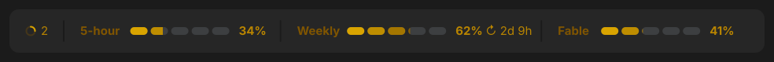

<p align="center">
  
</p>

<h1 align="center">goldbar</h1>

<p align="center">Your Claude usage limits, as a little bar of gold above the prompt.</p>

<p align="center">
  
</p>

goldbar is a [Claude Code](https://claude.com/claude-code) mod. It sits in the band directly above the prompt and shows how much of each usage limit you have spent:

- **Background tasks**: at the far left, a gold ring that spins with a count while background shells, subagents or monitors are running, and sits still at 0 when nothing is.
- **5-hour**: the rolling session window.
- **Weekly**: the all-models weekly limit, with `↻` and the time until it resets.
- **Fable**: one model's own weekly limit (Fable by default; any model `/usage` lists).

The pills fill left to right through deepening shades of gold. While Claude is working on a turn, a swell runs along the pills from left to right, so you can see at a glance that it is busy.

<p align="center">
  
</p>

## Install

At the prompt of a Claude Code terminal session:

```
/plugin install goldbar --marketplace brashProfile/goldbar
```

Answer `y` to add the marketplace, then pick a scope (user scope loads it in every session). The settings screen that follows can be skipped: every setting has a default.

From a shell:

```bash
claude plugin install goldbar --marketplace brashProfile/goldbar
```

In the Claude desktop app: click **+** next to the prompt box, then **Plugins**, **Add marketplace** with `brashProfile/goldbar`, then **Add plugin**.

## Settings

Every color, label and count is a setting. In a terminal session run `/plugin`, open goldbar and choose **Configure**, or set them in `~/.claude/settings.json` (a running session picks up changes on `/reload-plugins`):

```json
{
  "pluginConfigs": {
    "goldbar@goldbar": {
      "options": {
        "weeklyPills": 7,
        "goldStart": "#f2c200",
        "goldEnd": "#b07300",
        "modelName": "Opus"
      }
    }
  }
}
```

| Setting | Default | What it does |
|---|---|---|
| `showBackground` | `true` | Spinner and count of running background tasks |
| `showSession` | `true` | The 5-hour bar |
| `showWeekly` | `true` | The weekly bar |
| `showModel` | `true` | The model bar |
| `sessionLabel` | `5-hour` | Label for the 5-hour bar |
| `weeklyLabel` | `Weekly` | Label for the weekly bar |
| `modelName` | `Fable` | Which model's weekly limit the third bar shows |
| `sessionPills` | `5` | Pills in the 5-hour bar (1–14) |
| `weeklyPills` | `5` | Pills in the weekly bar (1–14) |
| `modelPills` | `5` | Pills in the model bar (1–14) |
| `goldStart` | `#d9a400` | Color of the first pill |
| `goldEnd` | `#6e4700` | Color of the last pill; the pills between shade from one to the other |
| `labelColor` | `#805500` | Bar labels |
| `valueColor` | `#b88400` | Percentages, reset time and task count |
| `dividerColor` | `#1b1b1b` | Lines between the bars |
| `trackColor` | `#8b949e` | Unfilled pills (drawn faint) |
| `showResetTime` | `true` | The `↻` countdown to the weekly reset |
| `pulse` | `true` | Pills swell left to right while Claude works |
| `pulseSeconds` | `1.6` | Seconds for one swell to cross a bar |
| `modelRefreshMinutes` | `2` | How often the model bar's figure is fetched, at most |

## What you need

- A Claude subscription (Pro, Max, Team or Enterprise). Usage limits are only reported for subscription sign-ins; with an API key the band stays empty.
- Claude Code with mod support (the `AbovePrompt` band), in the terminal or the desktop app.

## How it works

- The 5-hour and weekly figures come from the rate-limit readings Claude Code already receives with each response, so they update after every turn.
- The Fable figure comes from the same usage endpoint the `/usage` screen reads, called with your own session's sign-in at most every two minutes. Nothing is sent anywhere else.
- Before your first message in a new session there is no fresh reading yet, so the weekly bar shows the last one it saw, dimmed, with "(last seen … ago)".
- Background tasks are counted when the call that starts them returns, and cleared when their completion notice arrives (a task with no notice drops off after 6 hours).
- Collapse the band with the `[-]` beside it, or ctrl+x ctrl+a.

## Development

```bash
claude plugin validate .
claude plugin test .
```

Run it from a working copy with `claude --plugin-dir /path/to/goldbar`.

## License

MIT
