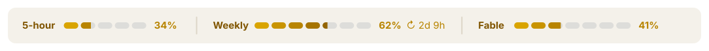

<p align="center">
  
</p>

<h1 align="center">goldbar</h1>

<p align="center">Your Claude usage limits, as a little bar of gold above the prompt.</p>

<p align="center">
  
</p>

goldbar is a [Claude Code](https://claude.com/claude-code) mod. It sits in the band directly above the prompt and shows how much of each usage limit you have spent:

- **5-hour**: the rolling session window, as five pills, one per hour.
- **Weekly**: the all-models weekly limit, as seven pills, one per day, with `↻` and the time until it resets.
- **Fable**: Fable's own weekly limit, as seven pills.

The pills fill left to right through deepening shades of gold. While Claude is working on a turn, a swell runs along the pills from left to right, so you can see at a glance that it is busy.

<p align="center">
  
</p>

## Install

At the prompt of a Claude Code terminal session:

```
/plugin install goldbar --marketplace brashProfile/goldbar
```

Answer `y` to add the marketplace, then pick a scope (user scope loads it in every session).

From a shell:

```bash
claude plugin install goldbar --marketplace brashProfile/goldbar
```

In the Claude desktop app: click **+** next to the prompt box, then **Plugins**, **Add marketplace** with `brashProfile/goldbar`, then **Add plugin**.

## What you need

- A Claude subscription (Pro, Max, Team or Enterprise). Usage limits are only reported for subscription sign-ins; with an API key the band stays empty.
- Claude Code with mod support (the `AbovePrompt` band), in the terminal or the desktop app.

## How it works

- The 5-hour and weekly figures come from the rate-limit readings Claude Code already receives with each response, so they update after every turn.
- The Fable figure comes from the same usage endpoint the `/usage` screen reads, called with your own session's sign-in at most every two minutes. Nothing is sent anywhere else.
- Before your first message in a new session there is no fresh reading yet, so the weekly bar shows the last one it saw, dimmed, with "(last seen … ago)".
- Collapse the band with the `[-]` beside it, or ctrl+x ctrl+a.

## Development

```bash
claude plugin validate .
claude plugin test .
```

Run it from a working copy with `claude --plugin-dir /path/to/goldbar`.

## License

MIT
